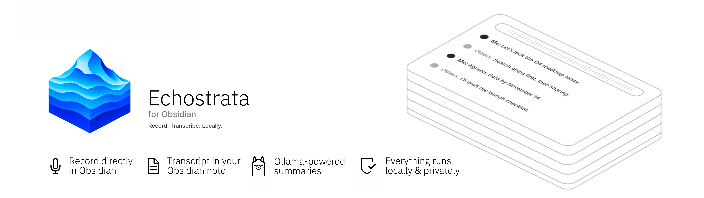
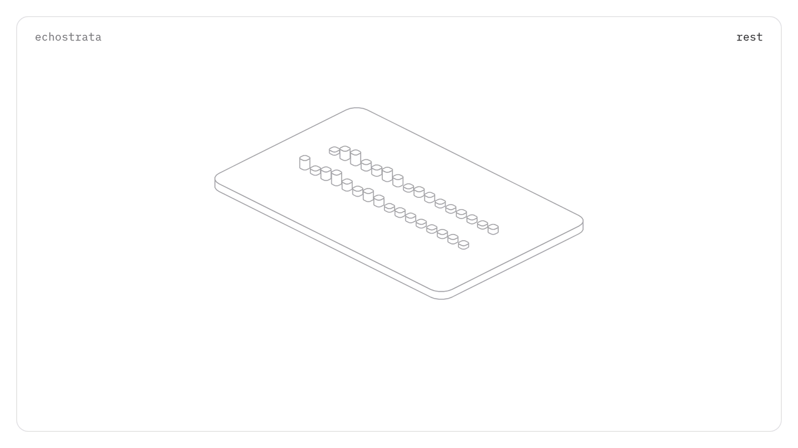

<p align="center">
  
</p>

<h1 align="center">Echostrata, for Obsidian</h1>

<p align="center">
  <strong>Record. Transcribe. Locally.</strong><br>
  Record your microphone and your Mac's system audio directly within the note you're writing.<br>
  Get a transcript, a summary and action items. Nothing leaves your Mac.
</p>

<p align="center">
  
  
  
  
</p>

<p align="center">
  
</p>

---

## Why Echostrata

Meeting tools upload your conversations to someone else's servers. Echostrata doesn't.

- **Mic + system audio.** Captures your voice *and* what your Mac plays: Zoom, Teams, Meet, a browser tab, a video.
- **Directly within Obsidian.** Click record in a note. The audio, transcript and summary land in that same note.
- **Knows who spoke.** Your mic and the system audio are recorded on separate channels, so lines are labelled **Me** and **Others** without any speaker-recognition model.
- **Summaries that fit the conversation.** A local model writes a title, summary and to-do checkboxes. Six [summary templates](#summary-templates) cover meetings, 1:1s, client calls, lectures, user interviews and voice memos.
- **Nothing leaves your Mac.** Transcription runs on [whisper.cpp](https://github.com/ggerganov/whisper.cpp), summaries on [Ollama](https://ollama.com). No account, no API key, no subscription, no cloud.

## What you get in your note

```markdown
![[Recording 2026-10-20 10.31.05.m4a]]

> [!abstract] Q4 roadmap sync
> The team agreed on the Q4 order: search first, then sharing. Beta date confirmed.
>
> **Key points**
> - Search ships before sharing
> - Beta locked for November 14
>
> **Action items**
> - [ ] Draft the launch checklist
> - [ ] Share the beta build with the team

> [!quote]- Transcript · 24:13 · Me / Others
> `00:00` **Me:** Let's lock the Q4 roadmap today.
>
> `00:07` **Others:** Search ships first, then sharing.
```

The transcript is folded by default so the summary stays on top.

## Features

| | |
|---|---|
| **One-click recording** | A mic button in the note header turns into a red **■ 03:12** timer while recording. The ribbon icon, a command and the status bar also start and stop recording. |
| **Floating recording bar** | Live waveform, separate Mic and System level meters, plus **Pause**, **Stop** and **Discard** buttons. After you stop, it shows transcription progress. |
| **Live note updates** | A "Recording…" placeholder appears where your cursor is. It becomes "Transcribing…", then the final result. |
| **Built-in system audio** | Uses Apple's ScreenCaptureKit. No virtual audio driver, no Multi-Output Device, and your volume keys keep working. |
| **Speaker labels** | Me / Others, with names you can change. Silent channels are skipped automatically. |
| **Local summaries** | Choose any model installed in Ollama from a dropdown. |
| **Guided setup** | A setup assistant checks and installs everything without opening Terminal. |
| **Long sessions** | Audio is written to disk as it records, and your Mac is kept awake while recording and transcribing. |
| **Clean output** | Whisper artefacts such as `[BLANK_AUDIO]`, `(music)` and repeated lines are filtered out. |

## Requirements

- **macOS 13 Ventura or later** for built-in system-audio capture. Older macOS versions can use [BlackHole](https://existential.audio/blackhole/) instead.
- **Obsidian 1.5.7+**, desktop.
- **[Homebrew](https://brew.sh)**, used to install whisper.cpp.
- **Xcode Command Line Tools**, used to build the small system-audio helper once. They're already installed if you have Homebrew.
- **[Ollama](https://ollama.com/download)**, *optional*, for summaries.
- About **0.6 GB** of disk for the default speech model, plus **2.6 GB** if you add `qwen3:4b` for summaries.

## Installation

### Manual

1. Download `main.js`, `manifest.json` and `styles.css` from the latest release.
2. Copy them into `<your vault>/.obsidian/plugins/echostrata/`.
3. In Obsidian, go to **Settings → Community plugins** and enable **Echostrata**.

### With BRAT

1. Install the **BRAT** community plugin.
2. **BRAT → Add beta plugin** → paste this repository's URL.

## Setup (about 5 minutes, no terminal)

The **setup assistant** opens the first time you enable the plugin. You can reopen it any time from **Settings → Echostrata → Open setup**. Each row turns green when it's ready:

| Step | What it does |
|---|---|
| **Microphone access** | Checks that macOS lets Obsidian use the microphone. |
| **Built-in system audio** | Click **Prepare** to build a small local helper (one time, about 30 s). |
| **Speech engine** | Installs `whisper-cpp` with Homebrew. It uses the Apple Silicon GPU. |
| **Speech model** | Downloads the default model (*Large v3 Turbo q5*, ~570 MB, multilingual). |
| **Summaries (Ollama)** | Optional. Pick an installed model, or download `qwen3:4b` / `qwen3:8b` with one click. |

**First recording:** macOS asks to allow Obsidian under **Privacy & Security → Screen & System Audio Recording**. Allow it, then **quit and reopen Obsidian**. The permission only takes effect after a restart.

**Check it works:** play a video, then click **Settings → Echostrata → Test system audio**. You should see ✅ and a level reading.

## Usage

1. Open a note and put your cursor where the recording should go.
2. Click the **🎙 button** in the note header, or run **Echostrata: Start / stop recording in current note**.
3. Talk, join your call, play your video. Use **Pause** or **Discard** from the floating bar if you need to.
4. Click **Stop**. Transcription starts right away, and the note fills in when it's done.

Processing time is roughly **1 minute per 20 minutes of audio**, plus a few seconds for the summary.

### Commands

| Command |
|---|
| Start / stop recording in current note |
| Pause / resume recording |
| Discard current recording |
| Record with template… |
| Open setup assistant |

Assign hotkeys in **Settings → Hotkeys → search "Echostrata"**.

### Summary templates

| Template | Use it for | Writes |
|---|---|---|
| **Meeting** (default) | Team meetings, syncs, workshops | Summary, decisions, key points, action items, open questions |
| **1:1** | Manager / report check-ins, mentoring | Topics, wins, concerns, feedback, commitments, next check-in |
| **Client call** | Discovery, pre-sales, account reviews | Context, needs, pain points, objections, stakeholders, deal signals, next steps, follow-up email |
| **Lecture & learning** | Courses, talks, webinars, tutorials | Outline, concepts, examples, takeaways, references, review questions |
| **User interview** | User research, usability tests | Profile, goals, pains, insights with evidence, opportunities, quotes |
| **Voice memo** | Thinking aloud, ideas, drafting | Core idea, ideas, structure, tasks, open questions, tags |

The template is chosen in this order, most specific first:

1. **Record with template…** (command palette), for one recording.
2. The note's `echostrata-template` property, for notes that are always the same type:
   ```yaml
   ---
   echostrata-template: client-call
   ---
   ```
   Valid values: `meeting`, `one-on-one`, `client-call`, `lecture`, `user-interview`, `voice-memo`.
3. **Settings → Summary template** (default: Meeting).

`qwen3:4b` handles every template. `qwen3:8b` gives noticeably better Client call and User interview results. If the model returns invalid JSON, Echostrata retries once. If that fails too, the transcript is still written, without a summary.

## Settings

| Section | Setting | Default |
|---|---|---|
| **Audio sources** | Microphone | System default |
| | System audio | Built-in macOS capture (BlackHole, a specific device or Off are also available) |
| | Test system audio | — |
| | Microphone echo cancellation | On |
| | Microphone level / System audio level | 1.0 / 1.0 |
| **Notes** | Insert recording at | Cursor position |
| | Recordings folder | Obsidian's attachment folder |
| **Transcription** | Speech model | Large v3 Turbo (q5) |
| | Language | Auto-detect |
| | Label speakers | On |
| | Speaker names | Me / Others |
| | Show timestamps | On |
| | Fold transcript callout | On |
| | whisper.cpp binary | Auto-detect |
| | CPU threads | Automatic |
| **Summary** | Generate a summary | On |
| | Summary template | Meeting |
| | Ollama URL | `http://127.0.0.1:11434` |
| | Ollama model | Dropdown of your installed models |
| **Other** | Keep Mac awake | On |

### Speech models

| Model | Size | Best for |
|---|---|---|
| Base | ~150 MB | Quick drafts |
| Small | ~490 MB | English, fast |
| **Large v3 Turbo (q5)** | **~570 MB** | **Best balance, multilingual (default)** |
| Large v3 Turbo | ~1.6 GB | Highest quality |

## Privacy

Echostrata is built so that **everything that should stay private, stays private.**

- **Recording** happens inside Obsidian. Audio files are saved in your vault, next to your notes.
- **Transcription** runs on your Mac with whisper.cpp. No audio is uploaded anywhere.
- **Summaries** run on your Mac with Ollama, which listens on `127.0.0.1` by default. Your transcript never goes to a remote AI service.
- **No telemetry.** No analytics, no account, no API keys.
- **Temporary files** (separate mic, system and mixed WAV tracks) are written to your system's temp folder and deleted when processing finishes.

**The only network traffic is the one-time setup downloads you trigger yourself:**

- whisper.cpp, via Homebrew (`brew.sh`) — triggered when you click **Install** in the setup assistant;
- the speech model, from Hugging Face (`huggingface.co`) — triggered when you click **Download** in the setup assistant;
- Ollama models, from the Ollama registry (`ollama.com`) — triggered when you click **Download** in the setup assistant.

These requests go to `brew.sh` and `ollama.com`. No request is ever made without you explicitly clicking a setup button. After setup, Echostrata works fully offline.

> If you point **Ollama URL** to a remote server, transcripts will be sent there for summarising. Keep the default `127.0.0.1` to stay fully local.

## System access disclosure

Echostrata is **desktop-only** and, to do its job locally, goes beyond Obsidian's vault API. It uses two powerful Node.js/Electron capabilities that Obsidian's plugin review flags. Here is exactly what they are used for, and nothing else:

### Filesystem access (Node.js `fs`, `os`, `path`)

| What | Where | Why |
|---|---|---|
| Writes temporary WAV files (mic, system, mix) | System temp folder, `obsidian-note-recorder/<id>/` | Streams audio to disk so long recordings don't fill memory. Deleted when processing finishes. |
| Writes the helper's Swift source | System temp folder, `nrt-system-audio-v*.swift` | Input for the one-time `swiftc` build below. |
| Reads and writes the plugin folder | `<vault>/.obsidian/plugins/echostrata/` | Stores the downloaded speech model (`models/`) and the compiled system-audio helper (`bin/`). |
| Reads the file you choose in the **Locate on this Mac…** picker | A path you pick | Lets you point to an existing `whisper-cli` binary. |

The recording itself (`.m4a`) and the note text are written through Obsidian's **vault API**, not `fs`.

### Shell execution (Node.js `child_process`)

Programs are started directly with an argument list, never through a shell string, and none of this runs until you start recording, transcribing or setup. The only program you can choose yourself is the whisper.cpp binary path.

| Command | When | Purpose |
|---|---|---|
| `whisper-cli` / `whisper-cpp` (auto-detected, or the path you set in **whisper.cpp binary**) | After you stop a recording | Local transcription. |
| `brew install whisper-cpp` | Only when you click **Install** in setup | Installs the speech engine. |
| `xcode-select -p` / `--install` | Setup assistant | Checks for, or installs, the Command Line Tools. |
| `swiftc` | Only when you click **Prepare** in setup | Compiles the bundled Swift source into the ScreenCaptureKit helper on your Mac. |
| Compiled system-audio helper | While recording with built-in capture | Streams system audio to the plugin over a pipe. |
| `caffeinate -i -m` | While recording or transcribing (if **Keep Mac awake** is on) | Prevents idle sleep. |
| `open` / `open -a` | Setup assistant buttons | Opens System Settings or Audio MIDI Setup. |
| `osascript` | Only when you click **Install BlackHole** | Opens Terminal with `brew install --cask blackhole-2ch`. |

### Network

External domains contacted by Echostrata:

| Domain | When | What |
|---|---|---|
| `brew.sh` | You click **Install** in the setup assistant | Downloads whisper-cpp via Homebrew |
| `ollama.com` | You click **Download** for a model in the setup assistant | Downloads an Ollama model |
| `huggingface.co` | You click **Download** for a speech model in the setup assistant | Downloads a Whisper model file |

All three are user-initiated one-time actions. No request happens automatically or in the background.

Runtime: the plugin makes HTTP requests to the **Ollama URL** you configure (default `127.0.0.1` — local only) to list and query installed models. If you change the URL to a remote host, requests to that host will include your transcripts.

### Release integrity

Release assets (`main.js`, `manifest.json`, `styles.css`) are built by GitHub Actions from a tagged commit with `npm ci`, and carry [GitHub build-provenance attestations](https://docs.github.com/en/actions/security-for-github-actions/using-artifact-attestations). Verify a download with `gh attestation verify main.js --repo SeneKela/echostrata-for-obsidian`.

## How it works

```
Microphone ──────────┐
                     ├─► Web Audio graph ──► MediaRecorder ──► Recording.m4a (your vault)
System audio ────────┘         │
(ScreenCaptureKit helper       └─► AudioWorklet: 48 kHz → 16 kHz, level meters
 or BlackHole)                          │
                                        └─► mic.wav · system.wav · mix.wav (temp, streamed to disk)

Stop ─► whisper.cpp on mic.wav + system.wav ─► merged by timestamp ─► Me / Others paragraphs
     ─► Ollama (JSON, chosen template) ─► structured summary ─► written into the note
```

- **System audio:** a tiny Swift program using Apple's ScreenCaptureKit captures what the Mac plays and streams it to the plugin. It's compiled on your Mac from source bundled in the plugin, so there's no prebuilt binary to trust.
- **Note updates:** the in-note placeholder is marked with invisible Obsidian comments (`%%…%%`), so it's updated in place and the markers are removed once the final content is written.

## Troubleshooting

| Symptom | Fix |
|---|---|
| "Microphone access denied" | **System Settings → Privacy & Security → Microphone →** enable Obsidian, then restart Obsidian. |
| Only **Me** in the transcript | System audio is blocked or Off. Allow Obsidian under **Screen & System Audio Recording**, restart, then run **Test system audio**. |
| Test system audio heard silence | Make sure something is actually playing. If it is, it's almost always the permission above. |
| "Building the system-audio helper failed" | Install the Command Line Tools (`xcode-select --install`), then click **Prepare** again. Or switch **System audio** to BlackHole. |
| "Transcription is not set up yet" | Open the setup assistant and finish **Speech engine** and **Speech model**. |
| No summary appears | Ollama isn't running, or no model is selected. Open Ollama, then pick a model in **Settings → Ollama model**. |
| Using BlackHole and you can't hear anything | Your output is set to BlackHole alone. Use a **Multi-Output Device** (speakers + BlackHole) in Audio MIDI Setup. |

## Building from source

```bash
git clone https://github.com/SeneKela/echostrata-for-obsidian
cd echostrata-for-obsidian
npm install
npm run build   # → main.js
npm run dev     # watch mode
```

Then copy `main.js`, `manifest.json` and `styles.css` into your vault's plugin folder.

Project layout:

```
src/
  main.ts           plugin entry, commands, recording lifecycle
  recorder.ts       Web Audio graph, AudioWorklet, MediaRecorder
  native-audio.ts   ScreenCaptureKit helper (Swift source, build, stream)
  devices.ts        microphone / loopback device detection
  session.ts        recording session + processing job (save → transcribe → summarise)
  transcriber.ts    whisper.cpp runner, models, paragraphs
  summarizer.ts     Ollama models and chat requests
  templates.ts      summary templates: prompts and note rendering
  template-modal.ts "Record with template…" picker
  note.ts           in-note block insert / update / remove
  ui.ts             header button, floating bar, ribbon, status bar
  setup.ts          setup assistant
  settings.ts       settings tab
  resampler.ts      streaming 48 → 16 kHz resampler
  wav.ts            streaming WAV writer
styles.css          Figma-style UI
```

## Roadmap

- [ ] Custom summary prompts and templates
- [ ] Live transcript while recording

## Credits

- Inspired by [Lecture Transcriber](https://github.com/AbyssLotus/obsidian-lecture-transcriber) by AbyssLotus.
- Speech recognition: [whisper.cpp](https://github.com/ggerganov/whisper.cpp) by Georgi Gerganov, using OpenAI's Whisper models.
- Local language models: [Ollama](https://ollama.com).
- Optional loopback driver: [BlackHole](https://existential.audio/blackhole/) by Existential Audio.

## License

[MIT](LICENSE) © Martin Burkel
